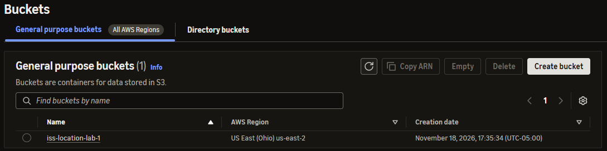

## Run the ISS location Lambda

1. Created an AWS Lambda Event Function named `iss-location-fetcher`.
2. In the Lambda code editor, I replaced the code with
   `src/lambda_function.py` and selected **Deploy**.
3. I ran a manual test and checked the response. The handler fetches its own
   data, so putting an empty JSON object (`{}`) is enough.

The test succeeded and returned `message: "success"`, a timestamp, and the ISS
latitude and longitude.

## Create the destination S3 bucket

1. I created a new project to hold the S3 general-purpose bucket.
2. For the settings, all default settings were left and named it `iss-location-lab`. What's important is to keep Block Public Access enabled, ACLS disabled, and select SSE-S3 for default encryption.

Now the bucket is setup to recieve the ISS data from account 1 through an authorized IAM role that will be setup next.

