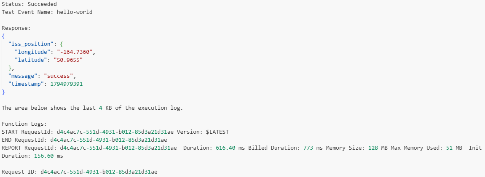

## Run the ISS location Lambda

1. Created an AWS Lambda Event Function named `iss-location-fetcher`.
2. In the Lambda code editor, I replaced the code with
   `src/lambda_function.py` and selected **Deploy**.
3. I ran a manual test and checked the response. The handler fetches its own
   data, so putting an empty JSON object (`{}`) is enough.

The test succeeded and returned `message: "success"`, a timestamp, and the ISS
latitude and longitude.

